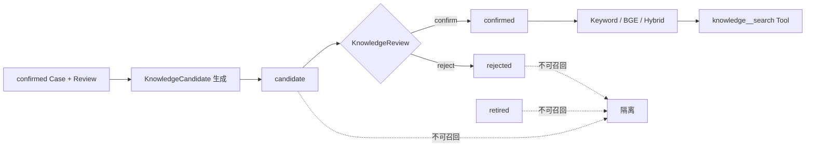

# 链路五：RAG 知识闭环如何工作

## 1. RAG 的重点先是治理，再是向量

本项目不是把诊断报告直接塞进向量库。知识先从已确认诊断生成候选，经过人工治理成为 confirmed，随后才
能被 Keyword、BGE 或 Hybrid Retriever 召回。

> 导航：横向定位（本项目 RAG 与通用文档 RAG 的本质差异）见第 11 节；
> 已知不足分级见第 12 节；后续拓展路线见第 13 节。



## 2. 从诊断到知识候选

[`application/knowledge_candidates.py`](../../src/security_diagnosis_harness/application/knowledge_candidates.py)
从 Case、结论、引用 Evidence 与 Review 组织 `KnowledgeCandidate`；
[`knowledge_governance.py`](../../src/security_diagnosis_harness/application/knowledge_governance.py)
负责保存与评审流程；领域状态机位于
[`domain/knowledge.py`](../../src/security_diagnosis_harness/domain/knowledge.py)。

生成入口必须要求来源诊断已被人工确认，并保留：source_diagnosis_id、source_conclusion_id、
source_evidence_ids、故障域、症状、根因、排障步骤与排除项。这样检索结果可追溯，不是孤立文本块。

## 3. 为什么 candidate 绝不能被召回

候选知识尚未经过治理，可能包含误判、偶然相关性或不完整步骤。如果它进入检索，再影响下一次诊断，就会
形成“模型猜测 → 写入知识 → 模型引用自身猜测”的反馈污染。Repository 的 `search_confirmed()` 与检索层都
必须限制状态，形成双重保护。

## 4. 三种检索路径

| 路径 | 优势 | 弱点 | 适合 |
| --- | --- | --- | --- |
| Keyword | 可解释、确定、无需服务 | 同义表达召回差 | 精确告警码、设备字段 |
| BGE Vector | 语义相似、能跨措辞 | 依赖 embedding 服务、可能语义漂移 | 自然语言症状 |
| Hybrid | 兼顾词法与语义 | 融合权重需评测 | 正式默认候选 |

核心实现位于
[`application/hybrid_knowledge_retriever.py`](../../src/security_diagnosis_harness/application/hybrid_knowledge_retriever.py)，
Embedding Port 的 HTTP BGE 实现在
[`adapters/embedding/http_bge.py`](../../src/security_diagnosis_harness/adapters/embedding/http_bge.py)。BGE 被设计为
独立本机服务，其他项目可复用，主服务未启动时不应被隐式拉起。

## 5. Hybrid 不是“把两个分数相加”就结束

需要明确：候选集合、分数归一化、权重、tie-break、limit、fault_type 过滤、状态过滤和 embedding 失败降级。
离线 `FakeEmbeddingAdapter` 用于确定性测试；真实 BGE 结果必须单独标记，不能与 Fake 指标混算。

## 6. 知识 Evidence 与设备 Evidence 的差异

`knowledge_sop` 能说明“过去如何处理过相似问题”，不能证明“当前设备现在就是这个故障”。因此它可以辅助
`possible` 候选、提供排障顺序，但不能单独支撑 `probable`。这是 RAG 与 CitationPolicy 之间最重要的接口。

## 7. 上帝视角追问与答案

### Q1：为什么不直接把所有 confirmed 报告向量化？

**答案：** 报告面向人读，可能含重复模板、审计信息和场景噪声。KnowledgeCandidate 是治理后的检索单元，
字段结构稳定、来源可追溯、生命周期可管理。向量化只是索引方式，不代替知识建模。

### Q2：为什么 confirmed 知识以后还需要 retired？

**答案：** 设备固件、平台策略和 SOP 会变化。历史知识曾经正确不代表永久有效；retired 让它保留审计历史但
退出召回，优于物理删除。

### Q3：BGE 服务不可用时怎么办？

**答案：** 失败必须可观测并受策略控制。可选择明确降级到 Keyword，但报告要标注实际 retriever；不能返回
Hybrid 名义指标，也不能启动隐藏的外部依赖。

### Q4：怎样证明 Hybrid 更好？

**答案：** 在固定、版本化、答案不泄漏的数据集上分别运行 Keyword/Vector/Hybrid，比较 Recall@K、MRR 等，
保留每条 query 的排名证据。当前小型固定集只能建立回归基线，不能声称广泛真实效果。

### Q5：RAG 能替代设备工具吗？

**答案：** 不能。RAG 提供历史经验和 SOP，设备工具提供现场事实。两者在 EvidenceType 与引用策略上刻意分离，
避免经验被误当现场观测。

### Q6：结构化知识量这么少，有必要用 RAG 吗？

**答案：** 在当前规模下（个位数知识条目、12 条检索评测），RAG 确实不是必需的——同样内容用硬编码或直接
塞入 prompt，召回效果相同。必须先把这一点认下来，再回答它真正解决什么。建议分三层：

1. **召回质量层**：当前不需要。12 条评测只能建立回归基线，证明不了广泛效果。
2. **知识生命周期层**：prompt 做不到。candidate / confirmed / rejected / retired 状态机中，`retired` 是关键——
   设备固件、平台策略与 SOP 都会变，历史知识曾经正确不代表永久有效；`retired` 让它保留审计历史但退出召回。
3. **反馈污染防护层**：与召回无关。若把未确认诊断直接向量化，会形成“模型猜测 → 写入知识 → 引用自身猜测”的闭环。

**口径：本项目 RAG 论证的不是“检索得更准”，而是“确认过的知识可以被安全复用”。这是一个治理命题，
不是召回命题。** 但当知识只有个位数时，该论证属于**机制演示**，不是效果证明。

RAG 真正变成必需的判据（用于回答“什么时候才该上 RAG”）：

- 知识条目超出 prompt 预算可容纳的数量（数十条以上）；
- 需要按设备型号、厂商、固件版本做多维过滤；
- 知识需要版本演进与退役管理（本项目只满足这一条）；
- 多站点 / 多租户隔离。

结论口径：当前 RAG 更接近**能力储备**，而非已验证的效果提升。

### Q7：预设知识如何避免绕过治理链路？

早期实现曾在 Tool 内保留 `DEFAULT_SOPS` 字面量，绕过候选、审核和退役状态。该缺口已经收敛：预设知识
位于 `samples/knowledge/default_sops.manual-seeds.json`，由
`KnowledgeGovernanceService.import_manual_seed()` 以 `source=manual_seed` 导入，随后仍须经过
`KnowledgeReview` 才能进入 confirmed 池。Tool 已删除硬编码回退；正式 Runtime 注入
`KnowledgeRepository`，只召回 confirmed 且未 retired 的条目。

这段历史值得保留，因为它说明治理约束必须覆盖冷启动数据。`IMPORTED` 仍是为未来批量摄取保留的来源类型，
当前没有正式的企业文档批量导入入口，不能把枚举存在描述成已经交付该能力。

### Q8：这是个人项目、没有存量知识，为什么还要有预设知识？算不算过度设计？

**不算。预设知识不是企业需求，而是任何知识系统的冷启动必要条件。**

关键在于：个人项目第一天没有已确认诊断可供沉淀，知识库需要冷启动内容。当前实现用受治理的
`KnowledgeCandidate(source=manual_seed)` 完成冷启动，与诊断沉淀知识共用审核、召回和退役规则；
空仓库仍会明确返回未命中，不再由 Tool 暗中提供字面量结果。

**顺带回答“个人项目里谁来 confirm”**：`manual_seed` 的语义就是人工种子，导入时由运营者以**稳定的
非个人标识**完成确认（例如 `system:manual-seed`），且这是**一次性批次动作**，成本可控。
因此治理链路在个人项目里同样走得通，不构成放弃治理的理由。

### Q9：如果接入真实企业环境，公司已有的 FAQ / 文档怎么入库？

**先声明场景假设，再回答假设性问题**：本项目是在个人电脑上完成的个人工程，**没有企业存量知识来源**。
因此这个问题应被理解为“如果迁移到真实环境，设计能否容纳存量知识”，而不是“项目为什么没做”。

正确的入库路径（不是直连向量库）：

```text
企业存量知识（Confluence / Excel / 工单知识库）
  -> 批量导入为 KnowledgeCandidate(source=imported)
  -> 一次性“批次审核”（不是逐条审核）
  -> 进入 confirmed 池
  -> 才可被检索
```

四个必要设计点：

1. **批次审核而非逐条审核**——数百条存量知识逐条审会让人放弃，这是能否落地的决定性前提；
2. **记录来源责任人**——谁确认的这一批；
3. **过期标记（TTL）与复审提醒**——存量知识中大量是临时处置方案，设备升级后即失效，`retired` 状态正为此存在；
4. **导入知识与诊断知识分开统计召回效果**——否则无法判断该往哪个方向投入。

**为什么原设计顺序是先“诊断 -> 知识”：** 诊断确认生成的知识天然带完整证据链
（`source_diagnosis_id` / `source_evidence_ids`）；存量文档没有证据链，无法知道撰写时基于什么设备与
固件版本。先打通可信度最高的来源、再扩展低可信来源，顺序是合理的，**代价是冷启动慢——这一点项目
尚未解决。**

**必须主动点出的张力：** “存量知识预先入库”与“confirmed-only 治理”存在冲突。允许免审核直入则治理
形同虚设；要求逐条审核则冷启动成本高到无人使用。项目选择了后者，代价是冷启动慢——**这不是设计错误，
但确实是一个尚未解决的工程问题。**

### Q10：不同格式的 PDF 需要不同策略处理，你们没考虑过这点？

**口径：不能说“没考虑”，要说“知识来源不同”。**

**第一步，知识来源不同。** 通用 RAG 的输入是 PDF / Word，必须从版式重建语义结构。本项目的输入是已人工
确认的诊断记录，写入时即为结构化（故障域、候选标签、根因、症状、排查步骤），因此**不存在“从版式文件
重建结构”这一段**。

**第二步，本质差异在痛点位置。**

| 维度 | 通用文档 RAG | 本项目 RAG |
| --- | --- | --- |
| 输入 | 外部文档（PDF / Word / HTML） | confirmed 诊断记录 |
| 核心难题 | **结构丢失**：从版式重建语义结构 | **结构可信**：结构已有，问题是准不准 |
| 检索单元 | 文本 chunk（随意切分） | 结构化 `KnowledgeCandidate` |
| 主要工程量 | 解析 / OCR / 分块 / 索引 | 治理 / 状态流转 / 来源追溯 |
| 失败模式 | 召回不到、切断语义 | 召回一条错经验并被复用 |

**第三步，若接入 PDF，不塞进现有链路。** 检索单元是结构化对象而非文本块，因此 PDF 层只负责**抽取**，
产出映射到既有 `title` / `root_cause` / `symptoms` / `troubleshooting_steps` 字段，不直接产 chunk。
**PDF 解析属上游抽取问题，不应污染下游检索契约。**

分格式策略（用于证明掌握，只是当前场景未用到）：

| 文档形态 | 处理策略 |
| --- | --- |
| 数字原生文本 PDF | 直接抽取文本（PyMuPDF / pdfplumber） |
| 扫描件 / 图片 PDF | OCR；必要时版面分析 |
| 双栏排版 | 分栏检测 + 按阅读顺序重排，否则两栏会串成一句 |
| 表格 | 表格识别后转结构化；行内容直接当段落会丢语义 |
| 公式 / 图表 | 专项识别或多模态描述 |
| 页眉页脚 / 页码 | 按位置或正则过滤 |
| 跨页段落 / 表格 | 合并 |
| 标题层级 | 按字号与加粗重建，作为切分边界 |

**第四步，诚实收尾。** 该能力只有设计层面的思考，没有实现也没有评测；当前检索评测集仅 12 条结构化短文本，
因此关于 PDF 解析效果没有任何结论，也不做声称。

**加分补充（主动给出优先级）：** 文档接入不是第一优先。检索层更该先补的是三个硬问题——无索引
（每次查询全量深拷贝）、一条知识一个向量（长文本会被 embedding 静默截断）、过滤维度只有故障域而
无设备型号 / 固件版本。这三条不解决，接入多少文档都难见效。

## 8. 关键代码与测试

- [`domain/knowledge.py`](../../src/security_diagnosis_harness/domain/knowledge.py)
- [`ports/knowledge_repository.py`](../../src/security_diagnosis_harness/ports/knowledge_repository.py)
- [`adapters/knowledge/in_memory.py`](../../src/security_diagnosis_harness/adapters/knowledge/in_memory.py)
- [`adapters/persistence/knowledge_repository.py`](../../src/security_diagnosis_harness/adapters/persistence/knowledge_repository.py)
- [`domain/knowledge_retrieval.py`](../../src/security_diagnosis_harness/domain/knowledge_retrieval.py)
- [`tests/test_eval_phase5.py`](../../tests/test_eval_phase5.py)

## 9. 绝不能误解

- BGE 是 embedding 模型，不是会自动回答问题的知识库。
- 向量相似不等于事实正确。
- confirmed 是治理状态，不是永不过期。
- FakeEmbedding 指标不能冒充真实 BGE 指标。
- 预设知识同样不能绕过治理：当前 manual seed 已走 `KnowledgeCandidate` 与 `KnowledgeReview`；
  Tool 内不再保留硬编码回退。
- 不是说“检索质量好”就等于“RAG 有价值”；本项目的论证对象是治理，不是召回效果。

## 10. 自测

1. candidate 被召回会造成什么反馈污染？
2. Hybrid 的哪些细节会影响可复现性？
3. 为什么 knowledge_sop 不能单独支撑 probable？
4. BGE 独立服务设计有什么复用和故障隔离价值？
5. 为什么“没有索引”在当前规模下不是优先问题？真正的性能瓶颈在哪里？
6. 预设知识（`DEFAULT_SOPS`）为什么必须走治理链路？在个人项目里由谁来完成这次确认？
7. 如果要把企业存量文档预先入库，必须经过哪几道关？会引入什么张力？
8. 本项目 RAG 与通用文档 RAG 的核心难题分别是什么？为什么 PDF 解析不属于本项目当前问题域？

## 11. 本项目 RAG 的定位与横向对比

**一句话定位（面试可直接使用）：**

> 本项目是一个“从诊断到知识”的闭环，不是“从文档到问答”的闭环。

**RAG 在本项目里是配角，不是主角。** 三条刻意设置的限制：

1. **Evidence 等级最低**：`KnowledgeSearchTool` 产出的 `knowledge_sop` 固定为 `reliability=LOW`，
   代码注释原话是“SOP 只是经验依据，可信度不能高于设备事实”；
2. **不能单独支撑高可信结论**：`CitationPolicy` 下只引用 `knowledge_sop` 时最多 `possible`，
   必须有至少两类设备事实证据才能到 `probable`；
3. **只召回人工确认知识**：`search_confirmed()` 在 Repository 与检索层双重限制
   `status is CONFIRMED`，candidate / rejected / retired 对模型完全不可见。

**职责边界：提供历史处置经验与排查顺序，绝不提供“当前设备现在就是这个故障”的证据**——后者只能来自只读设备工具。

| 维度 | 通用文档 RAG | 本项目 RAG |
| --- | --- | --- |
| 输入 | 外部文档（PDF / Word / HTML） | confirmed 诊断记录 |
| 核心难题 | 结构丢失（从版式重建语义结构） | 结构可信（结构已有，问题是准不准） |
| 检索单元 | 文本 chunk | 结构化 `KnowledgeCandidate` |
| 主要工程量 | 解析 / OCR / 分块 / 索引 | 治理 / 状态流转 / 来源追溯 |
| 失败的后果 | 召回不到 | 召回一条错的并复用 |

检索单元确实是结构化对象，而不是文本块：
`_candidate_text()` 把 `candidate_label` / `title` / `summary` / `root_cause` / `symptoms` /
`troubleshooting_steps` 拼接为一条文档文本，一条知识对应一个向量。

**归纳口径：**

> 通用 RAG 解决的是“把没有结构的东西变成可检索的”；本项目解决的是“只有被验证过的结构才允许被检索”。
> 前者是**信息抽取问题**，后者是**知识治理问题**。

## 12. 已知不足（分级）

| 级别 | 不足 | 依据与影响 |
| --- | --- | --- |
| 历史缺口，已修复 | `DEFAULT_SOPS` 硬编码与未注入 Retriever 曾绕过治理 | manual seed 已进入治理服务，正式 Runtime 已注入 Repository；回归覆盖 confirmed-only、retired 隔离与空仓库 |
| 能力边界 | 正式 Runtime 当前采用 Repository 关键词检索，未装配外部 BGE 服务 | BGE Adapter 已完成 endpoint、输入/响应、有限数值、错误映射、生命周期与响应 deadline 加固，但外部服务仍需显式部署和评测 |
| 尚未交付 | `IMPORTED` 来源已定义，企业文档批量摄取与批次审核入口尚未实现 | 不能把来源枚举当成已交付的导入能力 |
| 当前规模无影响 | 检索为全量扫描，且每次查询深拷贝整个知识库快照，未建索引 | 当前仅 4 条 SOP、12 条评测，无实测影响；**真实瓶颈是 `deepcopy` 而非余弦计算** |
| 潜在 | 一条知识一个向量，长文本会被 embedding 模型静默截断（bge-small-zh-v1.5 上限 512 token） | `_candidate_text()` 拼接 7 个字段整体 embed |
| 潜在 | 过滤维度只有 `fault_type`，无设备型号 / 厂商 / 固件版本 | 同一故障在不同型号上根因可能不同 |
| 质量 | 无 rerank；RRF 权重 `1.2 / 1.0`、`rrf_k=60`、`min_semantic_score=0.35` 均为手写常数；无查询改写；无知识冲突检测；无时间衰减 | 均无调参依据与评测支撑 |
| 评测 | 检索评测仅 12 条结构化短文本 | datasets README 原话：只能建立回归基线，不能声称广泛效果 |

**归纳口径：本项目的 RAG 深度在“治理”，不在“检索质量”。治理设计（confirmed-only、retired 保留审计、
来源可追溯）是完整的；检索层是薄的。**

## 13. 后续拓展路线

按“不引入外部依赖 → 引入外部依赖 → 规模化 → 非结构化来源”排序。每一阶段都必须先满足触发条件与前置门禁。

### 阶段 A：治理一致性（已完成）

- manual seed 文件、幂等导入、人工确认、正式 Runtime Repository 注入和 Tool 空结果语义均已落地；
- `DEFAULT_SOPS` 已删除，未确认与 retired 知识不可召回；
- `IMPORTED` 只保留领域语义，批量摄取尚未实现。

### 阶段 B：可选语义检索接入

- `HttpBgeEmbeddingAdapter` 的网络与资源门禁已完成；
- 接入正式 Runtime 前仍需提供显式配置、运行可观测性和真实 BGE 独立评测；
- BGE 不可用时必须记录 `keyword_fallback`，不得把 keyword 结果冒充 hybrid。

### 阶段 C：检索层加固（知识量达到阈值后）

- **触发条件（必须先测量，不可预先优化）**：confirmed 知识超过约 200 条，或 `search_confirmed`
  的 p95 延迟超过 100ms。
- **做法（按实测结果决定，不预先堆方案）**：消除每次查询的全量深拷贝；按 `fault_type` 分桶或引入
  向量索引；增加设备型号 / 厂商 / 固件版本过滤维度；引入分块以解决长文本截断；引入 rerank 与时间衰减。
- **约束**：先补基准测试再决定方案，不得为优化引入未评测的复杂度。

### 阶段 D：非结构化知识摄取（存在真实文档来源时）

- **触发条件**：存在真实 PDF / Word / 工单导出等非结构化来源，且已完成阶段 A。
- **做法（细节见第 7 节 Q10）**：分格式解析策略（文本型 / 扫描件 / 双栏 / 表格 / 跨页 / 页眉页脚 /
  标题层级）；解析层只负责抽取，产出映射到既有 `KnowledgeCandidate` 字段，不直接产 chunk；
  以 `source=imported` 导入并必须经批次审核进入 confirmed；记录来源责任人与 TTL / 复审提醒。
- **不做什么**：不修改检索层契约；不允许导入知识免审核直接进入召回。

### 排序理由

1. **阶段 A 已完成**：冷启动知识与正式召回已纳入同一治理链路。
2. **阶段 B 保持显式启用**：BGE Adapter 已加固，但部署外部服务和形成真实指标仍是独立决策。
3. **阶段 C / D 在无实测数据与真实来源之前就做，属于无依据投入。**
