# Security Device Diagnosis Harness —— 项目介绍 / 架构图 / 流程图 / 面试问答

> 说明：本文档面向面试准备与项目介绍。
>
> - 图示使用 **Mermaid** 编写，可在 GitHub、Obsidian、Typora、Markdown Preview Enhanced 等支持 Mermaid 的环境中直接渲染。
> - **每张 Mermaid 图都配有同内容的 SVG 版本**（位于 `docs/01-architecture/interview-0*.svg`），无法渲染 Mermaid 时直接看 SVG，两者内容一致、以 Mermaid 为准。
> - 内容重点不是“用了多少技术”，而是围绕 **为什么存在、失败怎么兜底、如何验证效果** 来组织。

---

# 1. 项目一句话介绍

这是一个**面向安防设备运维场景的可信诊断 Agent Harness**。它不是让 LLM 直接“看日志然后猜故障”，而是把模型放在一个受控的工程边界里：

- LLM 负责：**推理、决定下一步查什么、生成候选结论**
- 确定性代码负责：**Tool 权限、参数校验、Evidence 生成、Citation 校验、状态机、人工审核、知识沉淀与评测**

核心目标是解决：

1. **模型会把推测说成事实**
2. **模型不应该直接拥有设备访问权限**
3. **错误诊断不能直接污染后续 RAG 知识库**
4. **Agent 的效果不能只看“回答像不像”，还要能分层定位失败原因**

---

# 2. 3 分钟项目介绍（面试口语版）

我这个项目做的是一个面向安防设备运维场景的可信诊断 Agent，主要覆盖摄像头黑屏、录像缺失、门禁刷卡异常和报警误报这几类问题。

我最开始关注的不是怎么把大模型接进来，而是这个场景有一个比较明显的问题：传统规则系统对固定故障比较稳定，但是面对跨设备、跨协议、信息不完整的问题扩展成本比较高；而如果直接把设备日志或者状态交给大模型，又会出现另外一个问题，就是模型可能把推测说成事实，甚至调用不应该调用的设备接口。

所以我最后没有把它做成一个普通的 ChatBot，而是设计了一层 Agent Harness。核心思路是让 LLM 负责“推理和选择下一步需要什么信息”，确定性的程序负责“什么工具能调用、调用结果能不能成为证据、结论有没有足够证据以及最终能不能确认”。

具体来说，我做了几个比较关键的设计。

第一个是 **Tool Use**。我没有让模型直接访问设备 API，而是所有设备查询都必须通过 Tool Registry。每个工具都有明确的参数 Schema、权限、适用故障类型和风险等级，目前正式诊断链路只开放只读能力，比如查询设备状态、ONVIF 信息、RTSP 可达性和平台拉流状态。权限不足、参数错误或者设备调用失败都会变成结构化失败，而且失败结果不能生成 Evidence。这样解决的是“模型可以决定查什么，但不能决定自己有没有执行权限”的问题。

第二个是 **Evidence 和 Citation Policy**。工具成功之后，我不会直接把自然语言结果交给模型，而是先形成结构化 Evidence。模型生成候选根因的时候必须引用 Evidence。比如一个结论要达到 probable，不是模型自己说置信度高就可以，而是至少需要两类设备事实支持；如果只有 SOP 或者证据不足，就会被降级成 possible。最终 confirmed 结论只能由人工审核产生。所以模型的 confidence 和系统真正接受的 confidence 是分开的。

第三个是 **知识闭环**。我没有让每次诊断结果直接进入向量库，因为这样非常容易造成知识污染。只有经过人工确认的诊断，而且存在有效 Evidence 引用，才能生成 Knowledge Candidate；知识本身还需要再次审核，只有 confirmed knowledge 才能进入后续 RAG。检索上我做了关键词和 BGE 向量的 Hybrid Retrieval，再通过加权 RRF 融合；同时如果 Embedding 服务不可用，会确定性降级到关键词检索，而不是让整个 Agent 失效。

失败处理上我也尽量避免“无脑重试”。比如设备调用失败不会包装成 Evidence，也不会由 Agent 自动重复调用；Runner 本身还有最大轮次和最大 Tool Call 数量，避免模型进入无限循环。对于状态并发更新，我用了乐观锁，发生冲突以后要求重新读取状态，而不是自动重新执行 Agent 或人工审核操作。

最后是 **Eval**。我没有只用几个 Demo 判断效果，而是把评测拆成诊断标签、工具选择、Evidence 引用、敏感信息泄露、检索效果和完整 Agent Loop 等不同层级。这样如果结果变差，可以定位到底是 retrieval、tool、reasoning 还是 policy 出了问题。

所以这个项目对我来说，重点不是用了多少 Agent 技术，而是我尝试回答一个问题：**当 LLM 被放进一个真实的高风险业务流程以后，怎么通过工具权限、Evidence、Citation、Human Review、知识治理和 Eval，把一个概率性的模型放进一个确定性的工程边界里。**

---

# 3. 项目边界（建议面试时主动讲）

## 3.1 这个项目做什么

- 面向安防设备场景做**故障诊断**
- 当前重点覆盖：
  - 摄像头黑屏
  - 录像缺失
  - 门禁刷卡异常
  - 报警误报
- 强调：
  - 可追溯（Evidence / Citation）
  - 可控制（Tool Registry / 权限 / Risk）
  - 可回退（降级 / 人工审核）
  - 可验证（Eval / 回归门禁）

## 3.2 这个项目不做什么

- 不让 LLM 直接执行高风险设备写操作
- 不把模型输出直接当作 confirmed diagnosis
- 不把一次诊断结果自动写入长期知识库
- 不把 simulator 结果包装成线上真实准确率
- 不把它说成“全自动修复系统”或“生产级 AIOps 全家桶”

---

# 4. 总体架构图

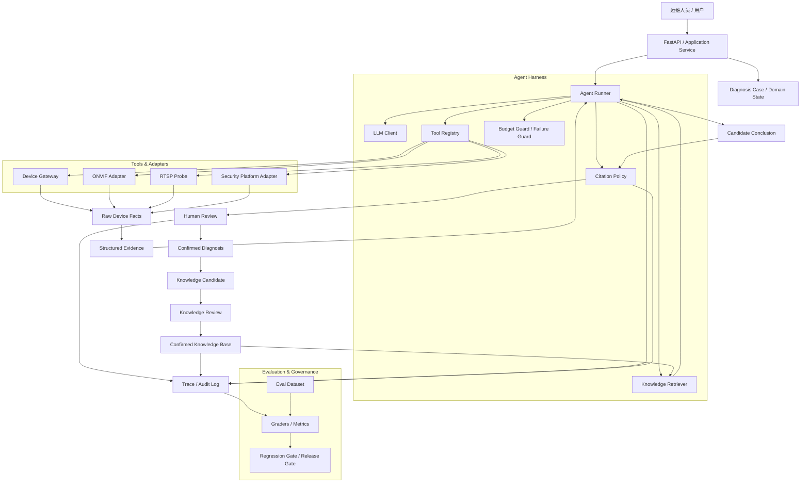

> **SVG 版**：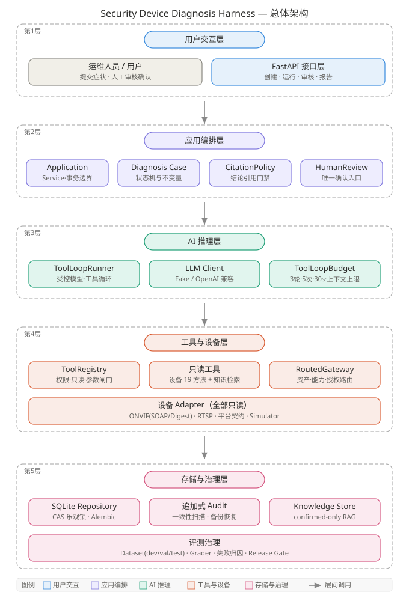 —— 不想渲染 Mermaid 时直接看这张，内容一致。

## 4.1 架构理解要点

这个架构里最重要的不是 API 或数据库，而是 **LLM 和真实系统之间的边界**：

- **Agent Runner**：负责受控的 Agent loop
- **Tool Registry**：决定“能不能查、查什么、怎么查”
- **Evidence**：把工具结果转换成结构化诊断事实
- **Citation Policy**：决定“模型的结论能不能成立”
- **Human Review**：决定“candidate 能不能升级成 confirmed”
- **Knowledge Gate**：决定“confirmed case 能不能沉淀成长期知识”
- **Eval**：决定“这次改动到底是进步还是退步”

---

# 5. 关键流程图

## 5.1 故障诊断主流程

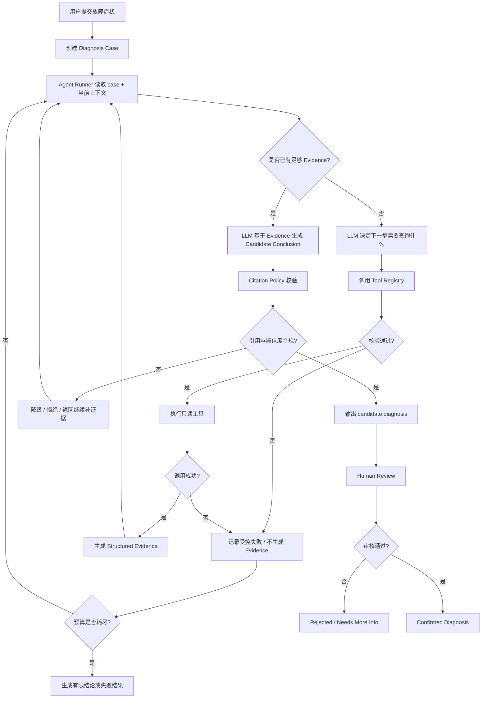

> **SVG 版**：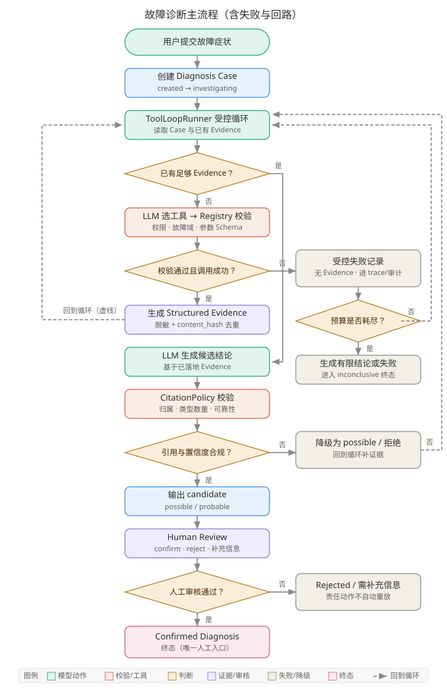 —— 含失败与回路，适合白板复述。

### 这一流程的工程意义

它说明这个系统不是“模型看到输入后直接输出答案”，而是：

1. 模型先判断**缺什么信息**
2. 信息必须通过**受控工具**获取
3. 只有成功、合法的工具结果才能成为 **Evidence**
4. 结论必须引用 Evidence，并经过 **Citation Policy**
5. 最终 **confirmed** 必须有人审

---

## 5.2 Tool 调用与 Evidence 生成流程

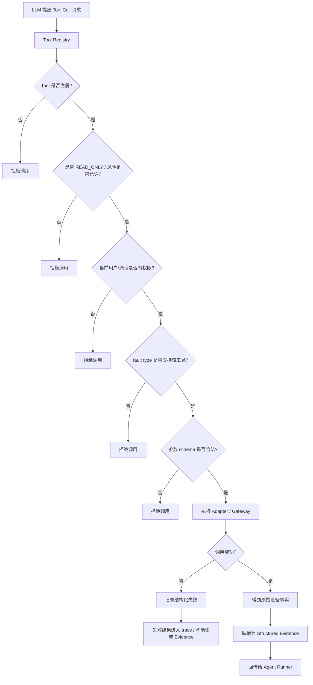

> **SVG 版**：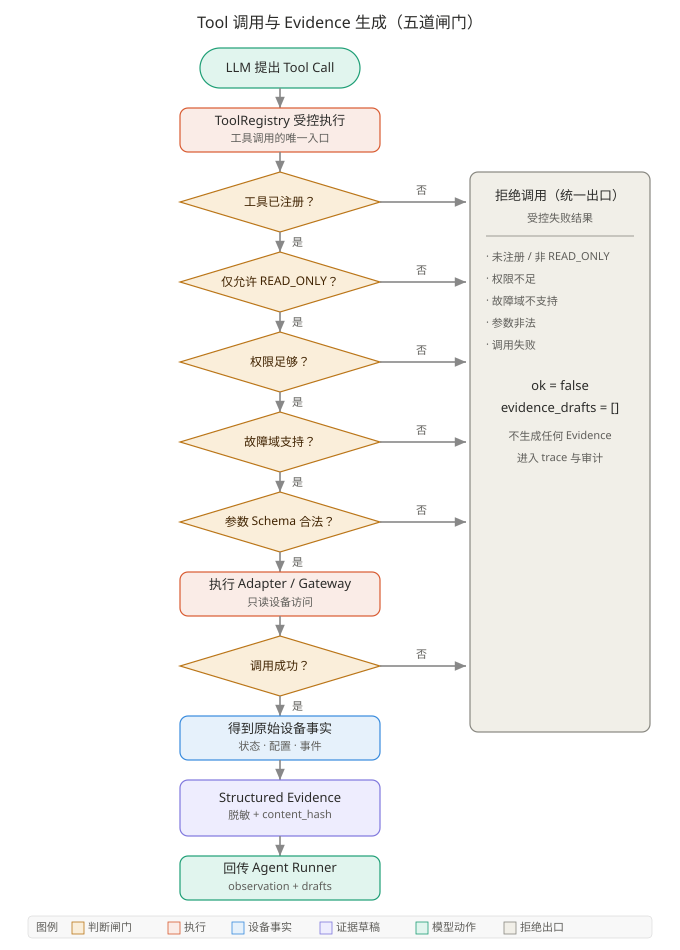 —— 五道闸门 + 统一拒绝出口（`evidence_drafts = []`）。

### 这一流程的工程意义

这张图重点在于：

- Tool Use 不是“模型随便调函数”
- 失败结果不等于业务事实
- Evidence 的语义必须是“经过验证的可用于诊断的事实”

---

## 5.3 Citation Policy 与结论分级流程

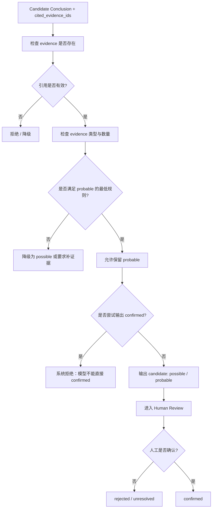

> **SVG 版**：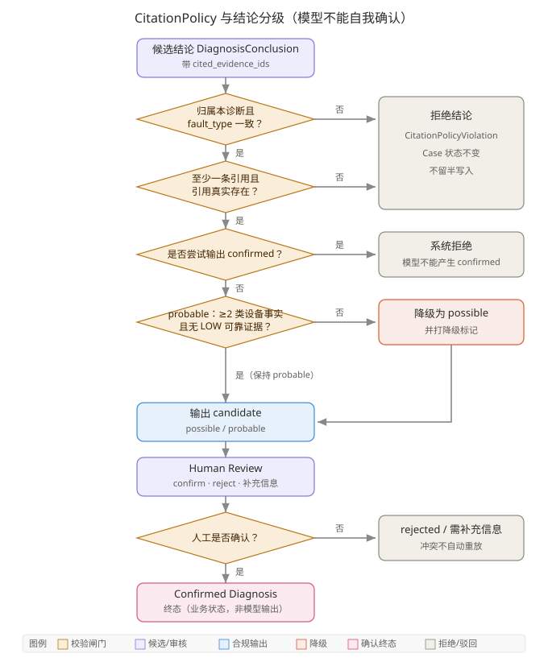 —— 五道校验闸门，confirmed 不在模型可信度枚举里。

### 这一流程的工程意义

这张图体现的不是“Prompt engineering”，而是：

- **模型可以表达 confidence，但不能拥有 confidence 的最终解释权**
- probable 不是模型说了算，而是 Policy 说了算
- confirmed 不是模型生成物，而是业务状态

---

## 5.4 知识沉淀与 RAG 闭环

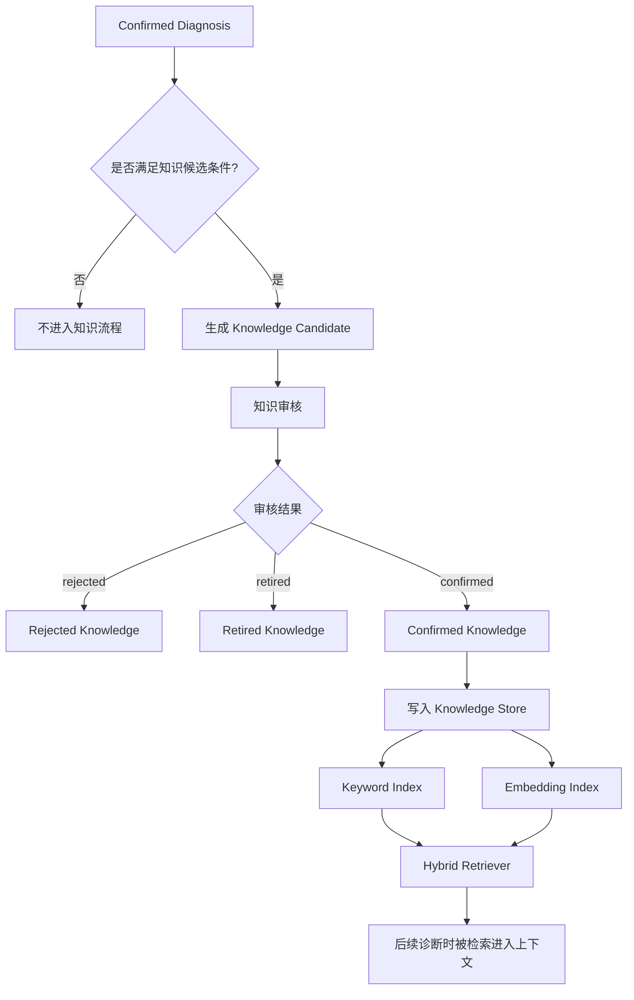

> **SVG 版**：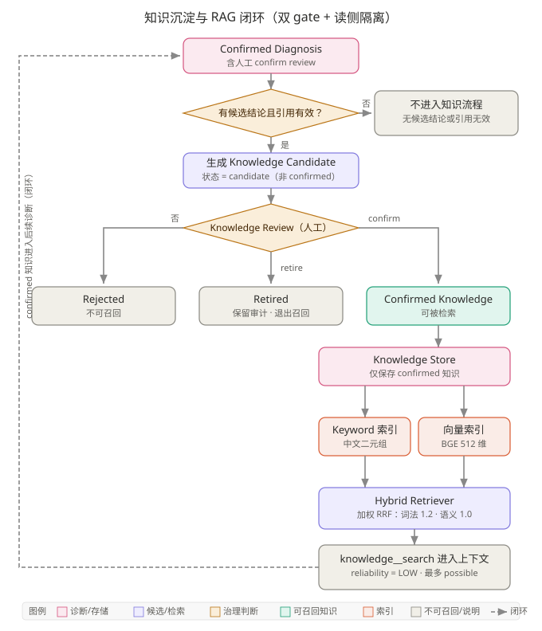 —— 双 gate + 读侧隔离，虚线是"知识回到后续诊断"的闭环。

### 这一流程的工程意义

重点是：

- 诊断结果不会直接写入知识库
- confirmed diagnosis 和 confirmed knowledge 是两个 gate
- 写入 gate 和读取 gate 分离，防止一次误诊长期污染系统

---

## 5.5 评测与回归门禁流程

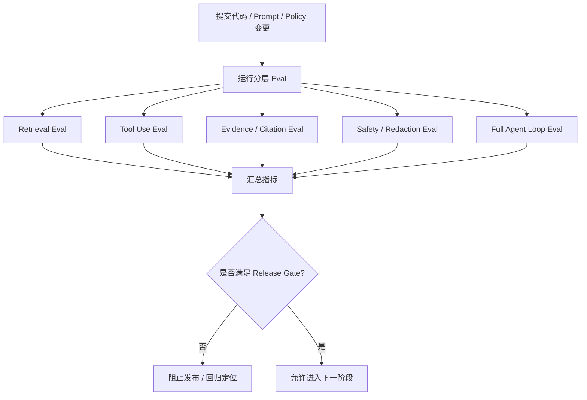

> **SVG 版**：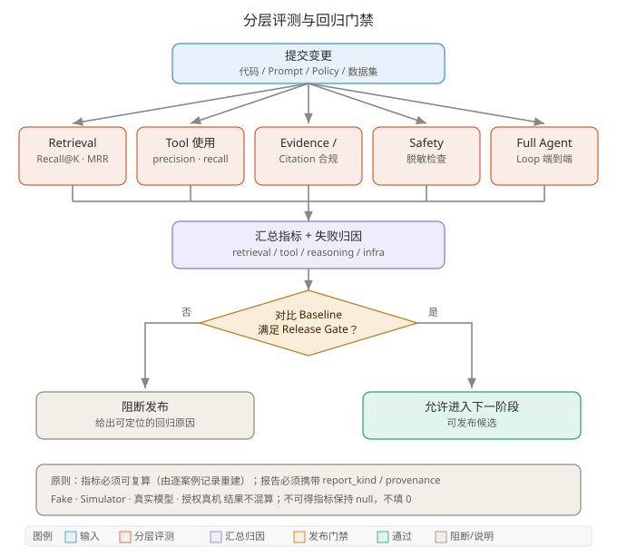 —— 五路分层评测汇聚到 Release Gate，底部注明可复算原则。

### 这一流程的工程意义

真正的 Agent 工程不能只看一个“最终正确率”，因为你必须知道：

- 是 Retrieval 错了
- 还是 Tool 失败了
- 还是 Citation 不合法
- 还是模型推理错了
- 还是安全策略拦住了本来正确的结果

## 5.6 一次诊断的完整时序（补充）

前面都是静态结构；面试常被要求现场讲"一次请求从头到尾发生了什么"，补一张时序图：

> **SVG 版**：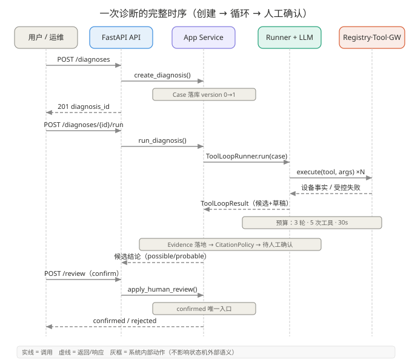 —— 创建 → 受控循环 → CitationPolicy → 人工确认，灰框是系统内部动作。

---

# 6. 为什么这个项目能写进简历

因为它不只是“用了什么技术”，而是每一个模块都能回答下面三件事：

1. **为什么存在**
2. **失败怎么办**
3. **怎么验证效果**

## 6.1 六个可讲清的工程判断

| 面试官关心什么 | 这个项目的回答 |
|---|---|
| 任务边界 | 诊断安防设备故障；模型不做最终确认，不执行高风险写操作 |
| 工具契约 | Tool Registry + schema + permission + risk；失败不形成 Evidence |
| 上下文策略 | 按需 Tool 获取事实，只把结构化 Evidence / approved knowledge 给模型 |
| 状态 / Memory | Diagnosis task state 与 confirmed domain knowledge 分开；不假装做 user memory |
| 权限确认 | 模型只能 candidate；confirmed 需要 Human Review |
| Eval | Label / Tool / Evidence / Citation / Retrieval / Safety / Agent Loop 分层评估 |

---

# 7. 简历写法（推荐版本）

## 7.1 不推荐写法（名词清单）

> 使用 FastAPI + RAG + Tool Use + Memory + Eval 构建安防智能诊断 Agent。

问题：

- 什么都有，但面试官不知道你解决了什么问题
- 不知道为什么用这些模块
- 不知道失败怎么兜底
- 不知道效果怎么衡量

## 7.2 推荐写法（工程师式）

### 简历条目版

**可信安防设备诊断 Agent Harness**

- 针对摄像头、录像、门禁与报警运维中 **LLM 易将推测当作事实、设备调用边界难控制** 的问题，设计 Evidence-grounded Agent Harness，将模型推理与 Tool 权限、状态机、Evidence 校验及 Human Review 分离，实现可追溯、可受控的诊断链路。
- 设计 Tool Registry 与只读设备工具契约，对参数、权限、故障域及风险等级进行确定性校验；设备调用失败不生成 Evidence，并通过 Tool Call/round budget 和受控降级避免无限重试与错误事实传播。
- 设计 Citation Policy，将模型置信判断与系统置信度解耦：候选结论必须引用真实 Evidence，probable 需至少两类设备事实支撑，confirmed 仅允许通过人工审核产生；confirmed case 经二次知识审核后才进入 RAG，降低错误诊断造成的知识污染。
- 构建 Keyword + BGE + weighted RRF 混合检索及分层 Eval；围绕 Retrieval、Tool、Citation、Safety 和 Agent Loop 建立回归门禁，使系统改动可被验证而不是凭主观判断上线。

### 面试时的核心定位句

> 这个项目不是一个简单的 LLM 设备问答系统，而是一个面向安防运维的可信 Agent Harness。我把设备状态、ONVIF/RTSP、平台状态和 SOP 转换成结构化 Evidence，让模型只负责基于 Evidence 做有限推理；Tool Registry 负责权限和风险控制，Citation Policy 负责验证结论是否有足够证据，最终 confirmed 结论必须经过人工确认。确认后的诊断再进入知识候选和 RAG，形成从诊断、验证到知识沉淀和回归评测的闭环。

---

# 8. 面试官最可能追问的 20 个问题（附回答思路）

> 注意：这里不是标准答案模板，而是“回答骨架”。你要记住每题背后的工程判断。
>
> **术语对照（口述时用代码里的类名更稳）**：文中“Agent Runner”对应 `ToolLoopRunner`；“Tool Registry”对应 `ToolRegistry`；“Device Gateway”对应 `DeviceGateway` / `RoutedDeviceGateway`；“Knowledge Gate”对应 `KnowledgeReview` + `knowledge_governance`。
>
> **一处需要纠正**：**`CitationPolicy` 是由 Application Service 调用的，不是 Runner。** Runner 只返回候选结论（`ToolLoopResult.final_conclusion`）；引用校验、Evidence 落地和状态推进都在 `application/diagnoses.py` 的 `run_diagnosis()` 里完成。第 4 节的架构图在这一点上是简化的。

## 1. 为什么这里需要 Agent？传统规则系统不行吗？

**回答思路：**

- 规则系统对固定故障稳定，但对跨协议、跨来源、信息不完整的动态诊断扩展成本高
- Agent 的价值不在“替代全部规则”，而在于**动态决定下一步需要查什么**
- 不确定的部分交给模型，确定的部分留在代码

**详细版：**

先承认一个事实：**这个项目里确实有一层确定性规则**（`application/camera_diagnosis_rules.py`），它按 R1→R6 的固定顺序从已落地的 Evidence 推断候选标签，只输出候选、不产生 confirmed。所以“规则能不能替代模型”必须有诚实答案。

- **固定案例集上，规则基本能覆盖。** 摄像头黑屏 5 个子场景 label 命中率 100%，这是确定性规则做的，不是模型。
- **规则吃亏的地方在入口和过程，不在结论。** 规则要求输入已经是结构化事实；但真实入口是“三号楼东门摄像头黑了，昨天还好好的”这种自然语言，而且“当前缺哪类事实、下一步该查什么”本身不确定。规则要覆盖这些分支，组合数会爆炸。
- 因此分工是：**LLM 负责动态决定采什么事实、组织解释与排障顺序；规则负责不可妥协的不变量**（候选标签的确定性推导、`CitationPolicy`、状态机）。
- 诚实边界：如果业务最终完全结构化（所有工单都带固定字段），**正确做法是减少 LLM，而不是为了 Agent 而 Agent**。这一点目前没有被真实数据验证过。

**面试回答版：**

> 我分两层答。第一层先承认：这个项目里是有一层确定性规则的，摄像头黑屏那 5 个固定子场景，规则命中率就是 100%，不需要模型。第二层是规则真正吃亏的地方——它要求输入已经是结构化事实，但真实工单入口是“东门摄像头黑了，昨天还好好的”这种描述，而且“当前缺哪类事实、下一步该查什么”本身是不确定的。所以我把分工定成：模型负责动态决定采什么事实、怎么组织排障顺序；规则和状态机负责那些不能妥协的不变量。如果以后业务完全结构化了，我会减少 LLM 用量，而不是硬留着 Agent。

---

## 2. 为什么不把所有设备信息一次性塞给 LLM？

**回答思路：**

- 上下文噪声大，Token 成本高
- 有些设备信息敏感，不应全量暴露
- 失去 Tool 权限与 Evidence 来源控制
- 更合理的做法是按需查询、按需补证据

**详细版：**

四个理由，按重要性排序：

1. **敏感信息。** 设备配置快照含凭证类字段。项目的做法是脱敏发生在**进入模型上下文之前**——`ToolEvidenceDraft` 与 `ToolExecutionResult` 都在构造期对 `summary` / `payload` / `observation` / `error` / `metadata` 执行脱敏，凭证统一替换为 `***REDACTED***`。全量塞入等于绕过这道边界。
2. **失去来源控制。** Evidence 的价值在于“这条事实从哪台设备、经哪个工具、何时采到”。全量塞入后模型引用的是“它读过的一段文本”，而不是带 `evidence_id` 与 `content_hash` 的结构化对象，`CitationPolicy` 就无从校验。
3. **权限不可撤回。** 按需查询意味着每次调用都要过 Registry 的权限、故障域、参数校验与授权预算。一次性全给，等于把“这次能不能看”变成“一开始就都看了”。
4. **成本与噪声。** Runner 有 `max_context_chars` 上限；无关事实会稀释注意力，也让失败定位变难（分不清是推理错了还是上下文混入了错误事实）。

**面试回答版：**

> 主要不是省 token，是三个边界问题。第一，设备配置里有凭证字段，我们的脱敏发生在进模型上下文之前，全量塞等于绕开这道边界。第二，Evidence 的价值在于可追溯——它是带哈希和 ID 的结构化对象，你全量塞进去，模型引用的就变成“它读过的一段文本”，引用校验就失效了。第三，按需查询意味着每次调用都要过 Registry 的权限、故障域和授权预算；一次性全给，等于把“这次能不能看”变成“一开始都看了”。所以按需查询本质上是让每一份事实进入系统都要过一道可审计的闸门。

---

## 3. 为什么一定要有 Tool Registry？

**回答思路：**

- Tool Registry 是模型和真实系统之间的 capability boundary
- 模型只能表达意图，Registry 决定是否真正允许执行
- 校验维度包括：是否注册、是否只读、是否有权限、故障域是否支持、参数是否合法

**详细版：**

Registry 是“模型与真实系统之间的能力边界”，不只是名字到实现的字典。`execute()` 的校验顺序固定：

1. **是否注册** —— 未注册直接受控失败；
2. **风险等级** —— 注册期只允许 `READ_ONLY`；**执行期再复查一次**，防止工具对象注册后被篡改风险等级绕过（纵深防御）；
3. **权限** —— `required_permissions - context.permissions` 非空即拒绝（`device:read` / `knowledge:read`）；
4. **故障域** —— `supported_fault_types` 不匹配即拒绝，避免摄像头诊断调用门禁工具；
5. **参数** —— 先过 Pydantic 输入模型；`ToolArgumentError` 只保留稳定文案，不回显 `input_value`；
6. **结果边界重建** —— 工具返回后再 `model_validate(model_dump())`，让嵌套脱敏 validator 重跑；不合法直接判失败。

另有一道结构性防绕过：`BaseTool.run()` 要求 `context.invoked_by_registry` 为真，否则抛 `ToolBypassError`。**绕过 Registry 直接调工具在代码层面做不到，不是靠约定。**

**面试回答版：**

> Registry 是模型和真实系统之间的能力边界。它不是名字到函数的字典，执行前有固定顺序的校验：是否注册、风险等级是否只读、权限是否够、当前故障域是否支持、参数 Schema 是否合法。两个细节我比较看重：一是风险等级在注册期和执行期各查一次，防止工具对象注册后被篡改绕过；二是工具返回结果会在 Registry 边界重新构造一次，让嵌套的脱敏校验再跑一遍。还有一道结构性防护——`BaseTool.run()` 要求一个由 Registry 注入的调用标记，否则直接抛异常，所以绕过 Registry 调工具在代码层面是做不到的，不是靠约定。

---

## 4. Tool 调用失败后为什么不自动重试？

**回答思路：**

- 失败不一定是瞬时网络抖动，也可能是设备离线、权限问题、配置错误
- 无脑 retry 可能放大设备压力，还会让 Agent 进入循环
- retry 应由 failure semantics 决定，而不是由“失败了”三个字决定

**详细版：**

先区分一件事：**“不自动重试”不等于“失败后不能换工具”。**

- **执行层不重试**：`RoutedDeviceGateway` 明确不 fallback、不广播、不自动重试；授权预算耗尽只拒绝，不扩容、不静默重置，要继续必须显式 `rotate()` 到新授权批次。
- **推理层可重新决策**：工具失败的 `observation` 会回传模型，模型可在下一轮选择另一个已授权工具，或承认事实不足。这是**重新决策**，不是重复同一次调用。
- **为什么不在执行层重试**：项目把失败分成稳定分类 `DeviceFailureKind`（12 类：`asset_not_found` / `asset_disabled` / `capability_missing` / `adapter_not_ready` / `authentication` / `timeout` / `rate_limited` / `unavailable` / `unsupported_capability` / `invalid_response` / `routing_context_required` / `unexpected`）。**只有 `timeout` 与 `unavailable` 可能瞬时恢复**；`authentication` / `capability_missing` / `asset_disabled` 重试多少次结果一样，`rate_limited` 重试反而加重限流。
- **预算兜底**：Runner 有 `max_tool_calls=5` 与 `max_rounds=3`。
- **若要加 retry**：应放在 Adapter / Gateway 层，按 failure kind 白名单做有限次数与退避，而不是在 Agent 循环里无差别重试——后者会让失败变成不可预测的耗时与成本。

**面试回答版：**

> 我先区分两个概念：执行层不重试，但推理层可以重新决策。执行层上，Router 不做 fallback、不广播、不自动重试；授权预算耗尽只拒绝、不扩容，要继续得显式开新授权批次。但工具的失败 observation 会回传给模型，模型可以在下一轮换一个已授权的工具，或者承认事实不足——那是重新决策，不是重复同一次调用。之所以不在执行层自动重试，是因为我们把失败分成了 12 类稳定分类，其中只有超时和服务不可用可能瞬时恢复；认证失败、能力缺失、资产禁用这些重试多少次都一样，限流重试还会加重压力。如果以后真要加 retry，我会按 failure kind 做白名单和有限退避，放在 Adapter 或 Gateway 层，而不是放在 Agent 循环里——否则失败会变成不可预测的耗时和成本。

---

## 5. 为什么失败的 Tool Result 不能成为 Evidence？

**回答思路：**

- Evidence 表示“已验证的业务事实”
- timeout / exception 只能说明“本次查询失败”，不能直接说明“设备故障”
- 否则会把 observation failure 混同为 domain fact

**详细版：**

项目里这是**结构性保证**，不是约定：

```python
# tools/contracts.py — ToolExecutionResult 的 model_validator
if not self.ok:
    self.evidence_drafts = []
```

只要 `ok=False`，无论工具自己传了什么草稿，都会在校验阶段被清空。配套的 `device_failure_result()` 只产出稳定文案与低基数 metadata（`failure_kind` / `operation`），不含任何 EvidenceDraft。

核心是**观测语义**问题：

- 一次超时只证明“本次调用没拿到响应”，可能来自本机网络、代理、授权预算或设备本身；
- 若把它写成一条 `device_unreachable` Evidence，就等于**把执行故障升级成设备事实**，后续 `CitationPolicy` 还会拿它去支撑 `probable`——错误被合法化了。
- 失败并未被丢弃：它进入运行轨迹、指标与审计，只是**不允许被引用为诊断依据**。

**面试回答版：**

> 这是一条结构性保证，不是约定。`ToolExecutionResult` 的校验里有一句：只要 `ok=False`，就把 `evidence_drafts` 强制清空——工具自己传了什么草稿都没用。原因是观测语义的问题：一次超时只能证明“本次调用没拿到响应”，它可能来自本机网络、代理、授权预算或者设备本身。如果我把它写成一条“设备不可达”的证据，就等于把执行故障升级成了设备事实，后面 CitationPolicy 还会拿它去支撑 probable，错误就被合法化了。失败不是被丢掉，它会进运行轨迹、指标和审计，只是不允许被引用为诊断依据。

---

## 6. 你怎么防止模型幻觉？

**回答思路：**

- 输入约束：只允许基于 Tool Evidence 和审核知识推理
- 输出约束：结论必须带 cited_evidence_ids
- 模型外校验：Citation Policy 再检查证据是否足够
- 不是试图让模型永不幻觉，而是让幻觉不能轻易穿过系统边界

**详细版：**

分四层，越往后越硬：

1. **输入层**：模型看到的不是原始设备报文，而是已脱敏的工具 `observation` 与 Evidence 摘要；可用工具受 `tool_allowlist` 限制。模型没有“自由看世界”的通道。
2. **输出结构层**：结论必须是 `DiagnosisConclusion`，而 `ConclusionConfidence` 只有 `possible` / `probable`——**模型在类型层面无法表达 `confirmed`，也无法表达 0.95 这类数值置信度**。
3. **领域校验层**：`SecurityDiagnosisCase.set_conclusion()` 检查 `diagnosis_id` 归属、`fault_type` 一致、以及**引用的 `evidence_id` 是否真实存在于当前聚合**。引用不存在的 ID 或别的诊断的 ID 直接抛 `UnknownEvidenceReference`；且因为检查发生在赋值与 `_touch()` 之前，**不会留下半写入状态**。
4. **策略层**：`CitationPolicy.validate()` 检查零引用、`probable` 的两类设备事实门槛、以及“不得依赖 `low` 可靠性设备事实”。

另有两个必须保留的诚实标记：`citation_repaired`（引用被 Harness 修正过）与 `confidence_downgraded`（可信度被降级过），并且 `model_cited_evidence_ids` 与 `cited_evidence_ids` **分开保存**——不能让“系统帮我修好了引用”被误认为“模型自己引用正确”。

口径：**目标不是让模型永不幻觉，而是让幻觉穿不过边界变成 confirmed。**

**面试回答版：**

> 我分四层做，越往后越硬。输入层，模型看到的是已脱敏的工具 observation 和 Evidence，可用工具受 allowlist 限制，它没有自由看世界的通道。输出层，结论的可信度枚举里只有 possible 和 probable，所以模型在类型层面就写不出 confirmed。领域层，`set_conclusion()` 会检查引用的 evidence_id 是否真实存在于当前聚合，引用不存在的 ID 会直接抛异常，而且检查发生在赋值之前，不会留下半写入。策略层，CitationPolicy 再查 probable 的两类设备事实门槛和低可靠证据。另外我把模型原始引用和 Harness 修正后的引用分开保存，还有 citation_repaired 和 confidence_downgraded 两个标记——因为不能让“系统帮我修好了引用”被误认为“模型自己引用正确”。说到底，目标不是让模型永不幻觉，而是让幻觉穿不过边界变成 confirmed。

---

## 7. 为什么 probable 要求至少两类 Evidence？

**回答思路：**

- 关注 evidence diversity，而不仅仅是 count
- 两类独立事实比同一事实重复两次更有价值
- 这是当前业务风险下的 policy，不是永恒真理，可根据真实 case 再标定

**详细版：**

常量为 `MIN_DEVICE_FACT_TYPES_FOR_PROBABLE = 2`，由 `device_fact_type_count()` 统计——统计的是**不同的 EvidenceType**，不是条数。

- **为什么是“类”不是“条”**：`add_evidence()` 按 `content_hash` 去重，同一份事实重复采到会直接返回已有那条。所以模型就算引用两条 Evidence，实际可能只是**同一次观测**。按类计数才真正保证多样性。
- **为什么是 2**：单一事实支撑高可信结论在设备诊断里风险很大。例如“码流状态异常”单独一条，可能是设备侧问题，也可能是平台侧问题，必须有第二类事实（设备在线状态或平台拉流状态）交叉印证。
- **还有一条同样重要但易被忽略**：`probable` **不能依赖 `reliability=LOW` 的设备事实**，防止“数量够了但质量不够”。
- **诚实边界**：这个 2 是**当前业务风险下的 policy，不是永恒真理**。应在真实 case 积累后重新标定（例如按故障域分别定阈值、引入误诊成本加权）。项目现在是硬编码常量，属已知简化。

**面试回答版：**

> 常量是 2，但关键在于是“两类”不是“两条”，代码里统计的是不同的 EvidenceType。为什么强调类：项目里 Evidence 是按 content_hash 去重的，同一份事实重复采到会返回已有那条，所以就算模型引用两条，也可能只是同一次观测。为什么是 2：单一事实支撑高可信结论在设备诊断里风险很大，比如“码流异常”单独一条，可能是设备侧也可能是平台侧，必须有第二类事实交叉印证。另外还有一条容易被忽略——probable 不能依赖可靠性为 low 的设备事实，防止数量够了但质量不够。最后我要诚实说，这个 2 是当前业务风险下的 policy，不是永恒真理，真实 case 积累后应该按故障域分别标定，现在是硬编码常量，这是已知的简化。

---

## 8. 模型自己输出 0.95 confidence 不行吗？

**回答思路：**

- model confidence 不等于 system confidence
- 模型可以表达 confidence，但不能拥有 confidence 的最终解释权
- 最终是否接受该 confidence，取决于 Citation Policy 和业务规则

**详细版：**

最直接的答案：**这个项目里模型根本没有输出数值置信度的接口。**

`ConclusionConfidence` 只有两个值 `possible` / `probable`，是字符串枚举，**没有 0.95 这个位置**。所以问题不是“我们拒绝 0.95”，而是“这种表达方式在类型系统里不存在”。为什么这么设计：

1. **数值置信度不可校准。** 不同模型、不同 Prompt 下同一个 0.95 含义完全不同，在评测里也无法与任何东西对齐。
2. **会造成双重权威。** 如果模型说 0.95 而系统说 `possible`，两者并存时日志、指标和调用方总会有人去读模型那个数，领域词义就失真了。这与“不让模型输出 confirmed 再由后端拒绝”是同一个道理。
3. **系统的 confidence 是可验证的结构化判断**：不是“模型觉得多确定”，而是“引用了几类设备事实、这些事实可靠性多高、引用归属是否正确”，这些都能复算。
4. 项目保留 `confidence_downgraded` 标记，所以**降级是显式可查的**——系统不会悄悄改掉模型的意思，而是记录下来。

**面试回答版：**

> 实际上这个项目里模型没有输出数值置信度的接口——`ConclusionConfidence` 只有 possible 和 probable 两个值，是字符串枚举，没有 0.95 这个位置。所以不是我们拒绝 0.95，而是这种表达在类型层面就不存在。这么设计有三个原因：第一，数值置信度不可校准，不同模型不同 Prompt 下同一个 0.95 含义完全不同；第二，如果模型说 0.95 而系统说是 possible，这两套权威并存，日志和指标里总有人去读模型那个数，领域词义就失真了——这和“不让模型输出 confirmed 再由后端拒绝”是同一个道理；第三，系统的 confidence 是可复算的，它不是“模型觉得多确定”，而是“引用了几类设备事实、可靠性多高、归属对不对”。另外如果发生降级，我们会打一个 confidence_downgraded 标记，让降级显式可查，而不是悄悄改掉模型的意思。

---

## 9. 为什么 confirmed 一定要人工审核？

**回答思路：**

- 设备运维属于高风险业务，错误结论可能带来错误操作
- 当前系统可以证明流程受控，不代表真实业务下已足够可靠
- 所以 candidate 和 confirmed 必须有清晰边界

**详细版：**

项目里这不是策略选择，而是**三条硬约束**：

1. **状态机层面 `confirmed` 不可达。** `ALLOWED_STATUS_TRANSITIONS` 中没有任何源状态的目标集合包含 `CONFIRMED`；`transition_to(CONFIRMED)` 直接抛 `InvalidStatusTransition`。
2. **唯一入口是人工动作。** 只有 `apply_human_review()` 在 `action=CONFIRM` 时才会置为 `confirmed`，且要求当前状态必须是 `waiting_for_confirmation`、且已存在候选结论。
3. **聚合不变量自检。** `_validate_aggregate()` 双向校验：状态为 `confirmed` 时必须有 conclusion 且**最后一条 review 必须是 confirm**；反之只要存在 confirm review，状态就必须是 `confirmed`。

业务理由：设备运维是高风险场景，错误结论会导致错误的现场操作（跑错现场、换错设备、把真实故障误判成“只是平台问题”而放过）。而且 `CitationPolicy` 只能证明“引用足够且归属正确”，**不能证明现实世界中结论一定正确**——设备事实可能过期、协议实现可能有缺陷、规则可能漏掉业务语境。

诚实边界：这**不等于**系统已经可靠，只说明流程受控、责任可归属。

**面试回答版：**

> 这个在项目里不是策略，是三条硬约束。第一，状态机层面 confirmed 不可达——所有状态跳转的目标集合里都没有它，直接调 transition_to 会抛异常。第二，唯一入口是人工动作，只有 apply_human_review 在 confirm 时才会把状态置为 confirmed，而且要求当前必须是 waiting_for_confirmation 并且已经有候选结论。第三，聚合自己还有一个不变量自检：状态是 confirmed 就必须有结论且最后一条 review 必须是 confirm；反过来只要有 confirm review 状态就必须是 confirmed，两个方向都堵住了。业务理由很直接：设备运维是高风险场景，错误结论会导致错误的现场动作。而且 CitationPolicy 只能证明引用足够、归属正确，它证明不了现实世界里结论一定对——事实可能过期、协议实现可能有缺陷。但我也要说清楚，这不等于系统已经很可靠，它只说明流程受控、责任可归属。

---

## 10. 为什么要 RAG？直接靠模型知识不行吗？

**回答思路：**

- 缺的不是通用知识，而是业务 SOP、历史确认 case、设备经验
- 这些知识持续变化，而且必须知道来源
- RAG 解决的是“可更新、可引用、可撤回”

**详细版：**

先讲清 RAG 在这个项目里的**真实角色**：它是配角，不是主角。三条刻意限制：

1. 它产出的 Evidence 是 `knowledge_sop`，可靠性固定为 `LOW`；
2. 只引用 SOP 时结论最多到 `possible`，够不到 `probable`；
3. 只能召回 `status is CONFIRMED` 的知识，且在 Repository 与检索层**双重过滤**。

为什么需要它，而不是靠模型参数记忆：

- 缺的不是通用知识，是**具体设备/平台的处置经验**（例如“某型号在固件 X 下会编码器超时”），这类知识模型参数里没有，且随固件与平台版本变化。
- 更重要的是**来源与撤回**：参数记忆回答不了“这条经验是谁确认的”“它还适不适用”。项目用 `retired` 状态解决“历史知识曾经正确但不代表永久有效”——保留审计历史但退出召回，优于物理删除。

**必须主动说的诚实边界**：在当前规模下（4 条预设 SOP、12 条检索评测），**RAG 确实不是必需的**，同样内容硬编码或塞 Prompt 效果一样。所以这个项目的 RAG 论证的是**“确认过的知识可以被安全复用”这个治理命题**，不是“检索得更准”。知识只有个位数时，它是**机制演示**而非效果证明。

RAG 真正必需的判据：知识条目超出 Prompt 预算（数十条以上）、需要按设备型号/厂商/固件多维过滤、需要版本演进与退役管理、多站点多租户隔离。目前只满足第三条。

**历史缺口与当前状态**：早期 `DEFAULT_SOPS` 曾硬编码在 Tool 内。当前已迁移为受治理的 manual seed，正式 Runtime 从 Repository 召回 confirmed 知识，Tool 不再提供硬编码回退。

**面试回答版：**

> 我先说 RAG 在这个项目里的真实定位——它是配角。它产出的证据是 knowledge_sop，可靠性固定为 low；只引用 SOP 时结论最多到 possible，够不到 probable；而且只能召回人工确认过的知识，在 Repository 和检索层双重过滤。为什么需要它：缺的不是通用知识，是具体设备平台的处置经验，比如某个型号在某个固件下会编码器超时，这类知识模型参数里没有，还会随版本变。更重要的是可撤回——模型参数记忆回答不了“这条经验谁确认的、还适不适用”，所以我们用 retired 状态让历史知识保留审计但退出召回。但我要主动说一个边界：在当前这个规模下，4 条 SOP、12 条评测，RAG 其实不是必需的，同样内容硬编码效果一样。所以这个项目的 RAG 论证的是“确认过的知识可以被安全复用”这个治理命题，不是检索更准，属于机制演示而不是效果证明。


---

## 11. 为什么不是纯向量检索，而是 Hybrid Retrieval？

**回答思路：**

- 语义描述适合向量检索
- 型号、错误码、协议字段等精确 token 适合关键词检索
- Hybrid 是在 recall 和 precision 之间做平衡

**详细版：**

设备诊断里同时存在两类性质相反的信息：

- **自然语言症状**：“刷卡之后毫无反应”“画面是黑的”，措辞多样，适合语义检索。
- **精确 token**：错误码（如 `ENCODER_TIMEOUT`）、型号、协议字段、告警类型名，**必须精确匹配**，向量检索反而容易把它们模糊掉。

实现上的几个具体选择：

- **中文词法用二元组切分**（`lexical_terms`），不是整句当一个词；并有最小交集阈值 `MIN_LEXICAL_OVERLAP = 2`。
- **语义路有最低相似度阈值** `min_semantic_score = 0.35`，避免强行匹配无关内容。
- **融合用 RRF**：`weight / (rrf_k + rank)`，`rrf_k = 60`，按**排名**而非分数融合，两路分数尺度不同也不影响结果。词法权重 `1.2`、语义 `1.0`，因为设备错误码与领域词的精确性更重要。
- **tie-break 用 `knowledge_id`**，保证同分时结果稳定可复现。

实测（12 条固定检索评测）：Recall@1 为 `0.75 / 0.75 / 0.8333`（Keyword / Vector / Hybrid），Recall@3 为 `0.75 / 1.0 / 1.0`，MRR 为 `0.75 / 0.8611 / 0.9028`。Hybrid 在 Recall@3 与 MRR 上确实优于单路，**但样本只有 12 条，只能算回归基线，不能当成广泛效果。**

**面试回答版：**

> 因为设备诊断里同时存在两种性质相反的信息。一种是自然语言症状，比如“刷卡之后毫无反应”，措辞很多样，适合语义检索。另一种是精确 token，比如错误码、型号、协议字段、告警类型名，这些必须精确匹配，纯向量反而容易模糊掉。实现上有几个具体选择：中文词法我用二元组切分而不是整句当一个词，有最小交集阈值；语义路有 0.35 的最低相似度阈值，避免强行匹配；融合用 RRF 按排名而不是分数融合，这样两路分数尺度不同也没关系，词法权重给到 1.2 略高于语义的 1.0，因为错误码这种精确信息的价值更高；同分时用 knowledge_id 做 tie-break，保证可复现。我们 12 条固定评测里 Hybrid 在 Recall@3 和 MRR 上确实优于单路，但样本只有 12 条，我只会把它当回归基线，不当广泛效果。

---

## 12. Embedding 服务挂了怎么办？

**回答思路：**

- 不让 Embedding 服务成为单点故障
- 降级到 keyword retrieval，允许效果下降但不让系统整体不可用
- degradation strategy 比“正常时跑得漂亮”更重要

**详细版：**

实现是**确定性且可观测的降级**：

```python
# application/hybrid_knowledge_retriever.py
try:
    semantic_rank = self._semantic_rank(safe_query, candidates)
except Exception:
    self.last_diagnostics = RetrievalDiagnostics(mode="keyword", semantic_fallback=True)
    return keyword_rank[:limit]
```

三个关键点：

1. **降级是显式的，不是静默的。** `last_diagnostics` 会把 `mode` 标成 `keyword`、`semantic_fallback=True`。ADR-001 明确要求：**不能把 keyword 结果冒充 hybrid 指标**，报告里写的 retriever 必须是实际生效的那个。
2. **降级决策在检索层内部，不在调用方。** 上层拿到的仍是 `list[KnowledgeCandidate]`，契约不变，不需要为 BGE 故障写分支。
3. **BGE 是独立服务，不被隐式拉起。** 它被设计为本机独立服务（`/v1/embeddings`），主服务启动时不会去拉它，避免“一个可选依赖变成启动硬依赖”。

**必须说清的现状**：`HttpBgeEmbeddingAdapter` 已补齐 endpoint allowlist、输入/响应大小限制、NaN/Infinity 拒绝、稳定错误映射、close 生命周期和响应 deadline。正式 Runtime 仍未装配外部 BGE 服务；当前正式召回使用 Repository 关键词路径，避免把可选外部依赖变成启动依赖。

**面试回答版：**

> 降级是确定性且可观测的：语义路失败后返回关键词排名，并记录 mode=keyword、semantic_fallback=true，不能把 keyword 结果冒充 hybrid。BGE 是独立服务，不会被主服务隐式拉起。HTTP Adapter 的 endpoint、资源、数值、错误、生命周期与 deadline 门禁已经补齐；正式 Runtime 仍保持 Repository 关键词召回，外部 BGE 需要显式配置和单独验收。

---

## 13. 你怎么防止错误诊断污染知识库？

**回答思路：**

- Diagnosis 要先经过 Human Review 成为 confirmed，才能变成 Knowledge Candidate
- Candidate 还要再次审核，只有 confirmed knowledge 才能进入 Retriever
- 写入 gate 和读取 gate 分离

**详细版：**

项目里有**两道 gate + 一道读侧隔离**：

**第一道（写入侧：诊断 → 知识候选）**：只有 `confirmed` 状态的诊断才能生成 `KnowledgeCandidate`，且要求存在人工 confirm 记录、有候选结论、有有效 Evidence 引用。生成的候选**始终是 `candidate`**，自动流程不可能产生 `confirmed`。

**第二道（治理侧：候选 → 确认知识）**：候选要经过 `KnowledgeReview`（`confirm` / `reject` / `retire`）才能变成 `confirmed`。且 `rejected` / `retired` **不允许重新 confirmed**。

**读侧隔离**：`search_confirmed()` 在 Repository 与 Retriever **双重**过滤 `status is CONFIRMED`。即使前两道出 bug，candidate 也进不了模型上下文。

防的是**反馈污染**：未确认的推测若能被召回，就会形成“模型猜测 → 写入知识 → 下次引用自己的猜测 → 强化”的闭环，错误自我放大。

**历史审计缺口已经闭环**：预设 SOP 已迁移到 manual seed 文件，通过治理服务导入并审核；正式 Runtime 注入 Repository，Tool 删除硬编码回退。`IMPORTED` 仍只代表未来导入来源，企业文档批量摄取尚未交付。

**面试回答版：**

> 有两道 gate，加一道读侧隔离。第一道在写入侧：只有人工确认过的诊断才能生成知识候选，并且必须有确认记录、结论和有效证据；自动流程只能生成 candidate。第二道在治理侧：候选经过知识审核才能变成 confirmed，rejected 和 retired 不能重新确认。读侧由 Repository 和 Retriever 双重过滤状态，阻断反馈污染。早期硬编码 SOP 的缺口已修复：预设知识现在也以 manual seed 候选进入同一治理链路。

---

## 14. 这个项目有长期 Memory 吗？

**回答思路：**

- 严格来说，没有做典型的 user profile memory
- 当前持久状态主要是 diagnosis task state 和 confirmed domain knowledge
- 后者更接近 organizational memory / experience memory

**详细版：**

**没有 user profile / 会话记忆。** 项目里持久化的状态只有两类：

| 类型 | 载体 | 生命周期 | 谁能改 |
| --- | --- | --- | --- |
| **Task state**（任务状态） | `SecurityDiagnosisCase` | 一次诊断，从 `created` 到终态 | 领域状态机 + 人工 review |
| **Organizational memory**（组织记忆） | `KnowledgeCandidate` | 长期，可 `retired` | 知识审核 |

两者的状态机**完全独立**：诊断有 `created` / `investigating` / `waiting_for_input` / `waiting_for_confirmation` / `confirmed` / `rejected` / `inconclusive`；知识有 `candidate` / `confirmed` / `rejected` / `retired`。**两者都含 `confirmed` 这个词，但语义与责任主体完全不同**——诊断的 confirmed 由运维复核产生，知识的 confirmed 由知识审核产生。这也是面试中极易被追问的一点。

为什么不做 user memory：这个场景下“用户偏好”对诊断没有价值，有价值的是“这台设备/这类故障历史上怎么解决的”，那属于**组织经验**而非个人画像。加 user memory 反而会引入一个既无法验证、也无法审计的状态源。

诚实边界：项目也没有跨会话的对话历史记忆，每次诊断都从 Case 聚合与已确认知识重建上下文。

**面试回答版：**

> 严格说没有做典型的 user profile memory。项目里持久化的状态只有两类：一类是任务状态，也就是 SecurityDiagnosisCase，它活一次诊断的生命周期；另一类是长期知识，也就是 KnowledgeCandidate。这两类的状态机是完全独立的——诊断有 created、investigating、waiting_for_confirmation、confirmed 这些状态，知识有 candidate、confirmed、rejected、retired，它们都有 confirmed 这个词，但语义和责任主体完全不同：诊断的 confirmed 是运维复核产生的，知识的 confirmed 是知识审核产生的。为什么不做 user memory：这个场景下用户偏好对诊断没有价值，有价值的是“这台设备这类故障历史上怎么解决的”，那属于组织经验，不是个人画像。加 user memory 反而会引入一个既无法验证也无法审计的状态源。

---

## 15. 如果要给这个项目增加长期 Memory，你会怎么定粒度？

**回答思路：**

- 不保存整段 conversation 原文作为长期记忆
- 长期记忆的最小单元应是能独立影响未来诊断的稳定事实或经验
- 例如：fault_type + symptom + confirmed_root_cause + conditions + troubleshooting_steps + provenance

**详细版：**

**这一题的答案项目里其实已经实现了一半**——`KnowledgeCandidate` 就是按这个原则设计的粒度：

```text
fault_type               故障域（决定它在哪些诊断里可被召回）
candidate_label          候选根因标签
title / summary          可读摘要
root_cause               根因
symptoms[]               症状
troubleshooting_steps[]  排查步骤
exclusions[]             排除项
source                   来源（diagnosis_confirmation / manual_seed / imported）
provenance               source_diagnosis_id / source_conclusion_id / source_evidence_ids
lifecycle                candidate / confirmed / rejected / retired
```

设计原则归纳成三条：

1. **不保存原文。** 保留的是从诊断提炼出的结构化字段，不是整段对话；只保留来源 ID 引用，**不复制完整 Evidence payload**。
2. **最小单元必须能独立影响未来诊断。** 一条记忆如果单独拿出来无法回答“什么现象下该做什么”，它还不该入库。
3. **必须带 provenance 与生命周期。** 没有来源的记忆无法审计，没有 `retired` 的记忆无法撤回。

**如果要扩展，当前粒度缺三样**（已知不足）：

- **适用条件**：没有设备型号 / 厂商 / 固件版本维度，但同一故障在不同型号上根因可能不同；
- **时效性**：没有时间衰减，也没有 TTL / 复审提醒，而设备经验会随固件过期；
- **冲突处理**：两条 confirmed 记忆矛盾时没有机制。

另一个粒度问题值得主动提：项目现在**一条知识一个向量**（`_candidate_text()` 把 7 个字段拼成一条文本），**没有分块**。未来接入长文档需要引入分块策略，但**块只是索引方式，不应取代结构化字段**。

**面试回答版：**

> 这个粒度我们其实实现了一半，知识候选就是按这个原则设计的。它的字段是：故障域、候选根因标签、标题、摘要、根因、症状列表、排查步骤、排除项，加上来源和 provenance，也就是来源诊断、结论和证据 ID，再加一个生命周期状态。三条设计原则：第一不保存原文，我们只保留来源 ID 引用，不复制完整 Evidence payload；第二最小单元必须能独立影响未来诊断，一条记忆如果单独拿出来回答不了“什么现象下该做什么”，它就不该入库；第三必须带 provenance 和生命周期，没有来源的无法审计，没有 retired 的无法撤回。如果扩展，现在的粒度缺三样：适用条件，比如设备型号和固件版本维度；时效性，没有时间衰减和复审提醒；还有冲突处理。另外我们目前是一条知识一个向量、没做分块，未来接长文档需要引入，但块只是索引方式，不该取代结构化字段。

---

## 16. 这个 Agent 怎么评估？

**回答思路：**

- 不只看最终正确率
- 分层看：candidate label、Tool selection、Evidence 完整性、Citation 合规性、Safety、Retrieval、完整 Agent Loop
- 这样回归时能定位到具体模块

**详细版：**

评测分四层：

**第一层：数据集。** `dev` / `validation` / `test` 三个划分语义不同——dev 日常调优、validation 版本比较、test 保持未见性做最终确认。**Test Set 反复用于调参就不再是 Test Set。** 数据集本身版本化并可验证发布；当前 1.0.0 只有 6 个协议基线案例，全部 synthetic。

**第二层：分项指标**（`evaluation/grader.py`）：

| 指标 | 回答的问题 |
| --- | --- |
| candidate accuracy / macro-F1 | 标签是否正确，且是否照顾小类 |
| tool precision / recall | 调的工具有多少必要 / 该调的有没有漏 |
| evidence compliance / recall | 引用是否合规 / 关键事实是否收集齐 |
| workflow success | 多步链路是否完成 |
| latency / calls / tokens | 效率与成本 |
| human review rate | 多少案例仍需人工争议处理 |

**第三层：失败归因**（`evaluation/attribution.py`）。把失败归到模型输出 / 工具选择 / 设备事实 / 引用 / 工作流 / 基础设施，并保留首次出现的 commit、数据集版本与受影响案例。**这一层的价值在于回答“是 retrieval 错了还是 reasoning 错了”**，而不是只留下“case failed”。

**第四层：发布门禁**（`evaluation/gate.py`）。`compare_runs()` + GatePolicy 把回归阈值转成发布决定。

三条必须坚持的原则：

1. **`EvaluationOutput` 必须由 grader 从真实 Case / Evidence / Conclusion / Review / 工具轨迹复算**，不能让执行者自报“我已人工确认”或“引用合规”——否则门禁可被伪造。
2. **宏 F1 必须从逐案例混淆矩阵复算**；空集 rate 的语义要显式，不能因为除零就给 1.0。
3. **结果来源不能混算**：Static/Fake、Simulator、真实模型、授权真机各自只能证明各自的东西，报告必须携带 `report_kind` / provenance；不可得指标保持 `null`，不能填 0。

**面试回答版：**

> 我分了四层。第一层是数据集，dev、validation、test 三个划分语义不同，test 反复用于调参就不再是 test。第二层是分项指标，标签用 accuracy 和 macro-F1，工具看 precision 和 recall，证据看 compliance 和 recall，还有 workflow success、延迟、调用次数和 token，以及人工复核率。第三层是失败归因，把失败定位到模型输出、工具选择、设备事实、引用、工作流还是基础设施，并保留首次出现的 commit 和受影响案例——这一层才是回答“到底是 retrieval 错了还是 reasoning 错了”的关键。第四层是发布门禁，把回归阈值变成发布决定。有三条原则我比较坚持：评测输出必须由 grader 从真实 Case、Evidence、Conclusion、Review 复算，不能让执行者自报，否则门禁可以被伪造；宏 F1 必须从逐案例混淆矩阵复算，不能因为除零就给 1.0；最后，Fake、Simulator、真实模型、授权真机的结果不能混算，报告必须带 report_kind，不可得指标保持 null 而不是填 0。

---

## 17. 评测集是自己编的吗？可信吗？

**回答思路：**

- 早期大量 case 是 synthetic / deterministic case，用于验证系统协议和安全边界
- 这类评测适合验证系统按设计工作，不等于真实世界准确率
- 要主动承认评测边界，而不是夸大结果

**详细版：**

**部分是自己构造的，这一点要直接承认。** 具体边界：

- 当前 `1.0.0` 数据集**只有 6 个协议基线案例，全部 synthetic**（datasets README 原话：“不能用于宣称生产准确率”）。
- 各故障域的固定案例集（摄像头 5、录像 5、门禁 5、报警 5）也是构造的，用于**功能回归与安全边界验证**。
- `samples/` 下的设备样例是手工构造的 JSON，由 `StaticDeviceGateway` 从本地读取。

所以它**能证明**：系统按设计工作（状态机、引用校验、脱敏、失败不产生 Evidence、门禁可复算），以及这些性质在改动后没有退化。**不能证明**：真实世界准确率、多厂商兼容、线上稳定性。

项目为此做了两件事提升可信度：

1. **数据集发布协议**：新版本需要**双人盲标 + 独立裁决 + 来源授权谱系 + 同域近重复检查**，且只在 staging 全量验证通过后才可见；已有语义版本禁止覆盖。发布回执**明确区分合成案例与授权业务案例**。
2. **结果来源强隔离**：报告必须带 `report_kind` / provenance；`simulator_stability`、`simulator_e2e`、`real_model`、`authorized_device_e2e` 这些标记**不得互相替代**，Simulator 十轮门禁与真机最小协议验收必须分别陈述。

诚实口径：**测试数量只能证明回归覆盖，不能证明业务正确。** 应说“在版本化 Validation Set 的 2 条受限案例上为 2/2”，而不是“准确率 100%”。

**面试回答版：**

> 部分是自己构造的，我直接承认。当前 1.0.0 数据集只有 6 个协议基线案例，全部是 synthetic，数据集 README 里明确写了不能用于宣称生产准确率；四个故障域的固定案例集也都是构造的，用途是功能回归和安全边界验证。所以它能证明的是：系统按设计工作，状态机、引用校验、脱敏、失败不产出证据、门禁可复算这些性质在改动后没有退化。它不能证明真实世界准确率、多厂商兼容或者线上稳定性。为了提升可信度我们做了两件事：一是数据集发布有协议，新版本要双人盲标、独立裁决、来源授权和近重复检查，发布回执里明确区分合成案例和授权业务案例；二是结果来源强隔离，simulator、真实模型、授权真机各有各的标记，不允许互相替代，Simulator 十轮门禁和真机最小协议验收必须分开陈述。我的口径是：测试数量只能证明回归覆盖，不能证明业务正确。所以我会说“在版本化验证集的 2 条受限案例上是 2/2”，不会说准确率 100%。

---

## 18. 如果某个指标很好，能说明系统就能上线吗？

**回答思路：**

- 不能
- 指标好只能说明特定数据集/特定场景下表现稳定
- 上线还需要真实授权 case、型号分层、时间切分、持续监控与人工兜底

**详细版：**

**不能，而且这个项目对这一点有正式的架构裁决。** [ADR-001](../01-architecture/ADR-001正式Runtime能力边界.md) 的决策原则原文是：

> 可重复评测能力不自动等同于正式服务能力。

展开说：

1. **一个指标好只说明它在特定数据集、模型、Prompt、配置、Runner、环境下稳定。** 项目规定：不同数据集、模型、Prompt、配置、Runner 或环境的结果**不能混入同一趋势**。
2. **正式能力必须与装配一致。** ADR-001 正是因为“组件存在”容易被误报成“生产链路可达”，才明确裁决：正式 Runtime 只开放摄像头黑屏一个域；扩域必须逐域满足 6 项门禁（资产目录有对应 capability、Registry 有 ready 且自检通过的 Adapter、Tool Registry 覆盖该域全部必要工具、能返回受控 candidate label、Runtime 级 API 与审计与降级用例通过、Simulator 与真机结果分开标识），**而不是扩大 allowlist 假装支持**。
3. **上线还缺什么**（真实缺口）：
   - 真实设备与真实 case 的规模（当前真机只有一台，只验证了协议层最小只读闭环）；
   - 平台侧对接与资产台账（最大空白，落地 90% 工作量在这里）；
   - 型号 / 固件分层（同一故障在不同型号根因不同，现在没有这个维度）；
   - 时间切分（现有验证集未按时间划分，无法反映设备演进）；
   - 持续监控与人工兜底机制。
4. **`null` 的处理是同一原则**：不可得指标保持 `null` 而非填 0，因为填 0 会污染趋势。

**面试回答版：**

> 不能。这个项目里有一条正式的架构裁决，原文是“可重复评测能力不自动等同于正式服务能力”。一个指标好只能说明它在该数据集、该模型、该 Prompt、该配置和该环境下稳定。我们有明确规定，不同数据集、模型、Prompt、配置、Runner 或环境的结果不能混入同一趋势。另外 ADR 里我特意做了个裁决：正式 Runtime 只开放摄像头黑屏一个故障域，其他三域虽然规则和固定评测都完成了，但不声明为默认可运行能力，因为我不想把“组件存在”误报成“生产链路可达”。要真正上线还缺几块：真实设备和真实 case 的规模，我们现在真机只有一台，只验证了协议层最小只读闭环；平台侧对接和资产台账，这块基本是空白，落地时大概 90% 的工作量在这里；还有型号和固件分层、时间切分、持续监控与人工兜底。这些都是我明确知道没做的。

---

## 19. 为什么采用单 Agent，而不是 Multi-Agent？

**回答思路：**

- 当前问题还没有复杂到需要多 Agent 协作
- 大部分职责差异可以通过 deterministic workflow + Tool boundary 解决
- 盲目拆 Agent 只会增加 handoff、延迟、状态同步和故障面
- Multi-Agent 是复杂度管理工具，不是能力勋章

**详细版：**

**这一题项目里有真实的实验经验可讲，不是空谈。**

项目里确实做过双 Agent 协作实验：用 Codex 做规划与验收、CodeBuddy 做实现，配 PowerShell 编排器处理进程退出、超时、活动与错误检测。**结论是小任务上协调成本高于收益。** 最后沉淀出的路由原则是——小任务直接做；明确机械的中型任务才委派；审查只看规格、关键 diff 与证据，不要传完整日志和轮询历史。

回到诊断场景本身，为什么不拆多 Agent：

1. **职责差异可以用确定性组件解决，不需要用 Agent 解决。** 项目里“负责权限”“负责引用校验”“负责状态推进”这些角色分别由 `ToolRegistry`、`CitationPolicy`、状态机承担——它们是**确定性代码，不是 Agent**。用 Agent 去做这些，等于把本来能证明的行为变成概率性的。
2. **拆分的成本是具体的**：handoff 要传状态、延迟叠加、故障面扩大、成本翻倍；而且**每个 Agent 都需要自己的预算与权限边界**——那等于把已经解决的安全问题重新打开一遍。
3. **当前任务并行度很低。** 一次诊断本质是串行的：确定故障域 → 采事实 → 校验引用 → 等人工。没有可并行分解的子问题。
4. **判断标准**：Multi-Agent 是**复杂度管理工具，不是能力勋章**。该不该拆，看的是“子任务之间是否真的可以独立验证、独立失败、独立限权”。

诚实边界：项目里 Codex + CodeBuddy 的实验是**开发流程**上的多 Agent，**不是运行时诊断链路**的多 Agent，两者不能混为一谈。

**面试回答版：**

> 我确实做过双 Agent 的实验，不过要说明那是开发流程上的，不是诊断运行时的。当时用 Codex 做规划和验收、CodeBuddy 做实现，配了进程编排器。结论是小任务上协调成本高于收益，最后沉淀的原则变成：小任务直接做，明确机械的中型任务才委派。回到诊断场景本身，不拆的理由有三个。第一，职责差异可以用确定性组件解决——“负责权限”“负责引用校验”“负责状态推进”这些角色，在项目里是 ToolRegistry、CitationPolicy 和状态机，它们是确定性代码不是 Agent，用 Agent 去做等于把本来能证明的行为变成概率性的。第二，拆分的成本很具体：handoff 要传状态、延迟叠加、故障面扩大，而且每个 Agent 都要有自己的预算和权限边界，等于把已经解决的安全问题重新打开一遍。第三，这个任务的并行度本来就低，一次诊断是串行的。我的判断标准是：Multi-Agent 是复杂度管理工具，不是能力勋章，该不该拆要看子任务是否真的能独立验证、独立失败、独立限权。

---

## 20. 如果继续做成生产系统，你下一步先改什么？

**回答思路：**

- 不是先换更大的模型
- 优先补真实业务闭环：
  - 更多真实设备和真实 case
  - 更细的 failure taxonomy 与 retry policy
  - 更强的 trace / observability
  - 根据误诊成本重新标定 Citation Policy 和 Human Review 阈值
- 生产 Agent 最重要的是知道错在哪里，以及能否安全停止

**详细版：**

**顺序很重要，而且第一件事不是模型。** 项目里已有一份排过序的路线（ADR-001 的门禁 + 知识侧拓展阶段 A–D），可以按优先级讲：

**第 0 优先：治理一致性（已完成）**
预设 SOP 已迁移为 manual seed，经 `KnowledgeCandidate` / `KnowledgeReview` 进入 confirmed 池；正式 Runtime 从 Repository 召回，硬编码回退已删除。后续重点是扩充真实业务样本和实现受控的 `IMPORTED` 批量摄取。

**第 1 优先：真实业务闭环，而不是更大的模型**
- **平台侧对接 + 资产台账。** 这是落地真正的第一道门：没有 CMDB，路由层连第一步都走不了；设备侧还有大量海康/大华私有协议，ONVIF 覆盖率有限。**这一步不解决，后面全是空转。**
- 更多真实设备与真实 case（当前真机只有一台，且只验证协议层）。
- **顺序上的反思**：项目实际把大量精力投在“拿到事实之后敢不敢信”，而“事实能不能拿到”只验证了一台设备。如果重做，我会先验证对接可行性——**这是我最想改的一点**。

**第 2 优先：让它“可运维”**
- 更强的 trace / observability：现有追加式审计与低基数指标，但缺跨链路的端到端追踪。
- 更细的 failure taxonomy 与 retry policy：现在是 12 类稳定分类 + 不自动重试。面向生产需按 failure kind 定义**哪些可重试、重试几次、退避多少**，并明确计量单位（Digest 下一次业务操作可能是两次网络交换）。
- 生产 Agent 最需要的能力是**知道错在哪里、以及能否安全停止**——所以可停止性与可观测性优先于准确率提升。

**第 3 优先：按误诊成本重新标定阈值**
- `MIN_DEVICE_FACT_TYPES_FOR_PROBABLE = 2` 现在是硬编码常量，应按故障域、按误诊成本加权重新标定。
- Human Review 介入阈值同理：现在 100% 人工确认是刻意的安全默认值，规模化后需要分级。

**明确不做的**：先换更大模型。因为这个项目的瓶颈从来不是模型智力，而是**事实能不能拿到**和**错了能不能查出来**。

**面试回答版：**

> 顺序上第一件事不是模型。我会分三步。第一步先修一个治理一致性问题：项目里预设 SOP 是硬编码的，它绕过了知识审核，而且没法 retired，同时我们定义了两个知识来源枚举却从没用过。修它零外部依赖、不改变任何能力边界。第二步是真实业务闭环——平台侧对接和资产台账。这是落地真正的第一道门，没有资产台账，路由层第一步就走不下去，而且设备侧还有大量海康大华的私有协议，ONVIF 覆盖率有限。这里我要做个反思：这个项目我把大量精力投在“拿到事实之后敢不敢信”，但“事实到底能不能拿到”只验证了一台设备；如果重做，我会先验证对接可行性，因为这一步不通，后面全是空转。第三步是让它可运维：更细的 failure taxonomy 和 retry policy，明确哪些失败可重试、退避多少，以及更强的端到端 trace。生产 Agent 最需要的能力不是更准，而是知道错在哪里、以及能不能安全停下来。所以明确不做的是先换更大的模型——这个项目的瓶颈从来不是模型智力。

---

# 9. 面试前自检清单（强烈建议）

如果你准备把这个项目写进简历，至少要能回答下面这些“为什么”：

## 9.1 关于 Tool Use

- 为什么不能让模型直接调设备 API？
- 为什么工具必须先过 Registry？
- 为什么失败调用不能生成 Evidence？
- 为什么这里选择 no-auto-retry？
- 未来如果要 retry，应该放在哪一层？

## 9.2 关于 RAG / Knowledge

- 这里缺的到底是什么信息？为什么模型参数记忆不够？
- 为什么知识不能直接写入向量库？
- 为什么写入和读取要有两个 gate？
- 为什么要 Hybrid Retrieval，而不是纯向量？
- 降级策略是什么？

## 9.3 关于 Memory / State

- 当前项目里的“状态”有哪些？
- 哪些是 task state，哪些算 domain knowledge？
- 如果未来加长期 Memory，粒度如何设计？
- 用户是否需要参与长期记忆写入确认？
- 记忆冲突时怎么处理？

## 9.4 关于 Eval

- 你为什么不用“最终正确率”一个指标解决一切？
- 如果完整答案错了，你怎么知道是 retrieval 还是 reasoning 的问题？
- 评测集为什么不能全靠自己编例子？
- simulator case 的评测边界是什么？
- 什么情况下应该阻止发布？

---

# 10. 一页式总结（适合最后背诵）

## 10.1 这个项目的本质

> 不是一个简单的“LLM 看设备状态然后回答”的项目，而是一个把概率模型放进确定性工程边界里的 **可信 Agent Harness**。

## 10.2 六个最关键的设计判断

1. **模型不直接拥有设备访问权限** → Tool Registry
2. **工具成功结果才有资格成为诊断事实** → Evidence
3. **模型不能自己定义自己的置信度是否成立** → Citation Policy
4. **高风险状态升级不能靠模型自己完成** → Human Review
5. **错误诊断不能污染未来系统记忆** → Knowledge Gate
6. **系统变好还是变差不能靠感觉** → Layered Eval

## 10.3 面试时最值得强调的一句话

> 我不是在做“会回答问题的大模型”，而是在做“让大模型进入高风险业务流程后仍然可控、可追溯、可验证”的工程系统。

---

# 11. 可直接复制到简历的精简版描述

**可信安防设备诊断 Agent Harness**

- 面向摄像头、录像、门禁和报警运维场景，设计 Evidence-grounded Agent Harness，将 LLM 推理与 Tool 权限、Evidence 校验、Human Review 和知识治理解耦，实现可追溯、可受控的故障诊断链路。
- 设计 Tool Registry 与只读设备工具契约，对参数、权限、故障域和风险等级进行确定性校验；设备调用失败不生成 Evidence，并通过预算限制与受控降级避免无限重试和错误事实传播。
- 设计 Citation Policy，将模型置信判断与系统置信度解耦：候选结论必须引用 Evidence，probable 需多类设备事实支撑，confirmed 仅允许通过人工审核产生；confirmed case 经二次审核后才能进入 RAG，降低知识污染风险。
- 构建 Keyword + Embedding 的 Hybrid Retrieval 及分层 Eval，从 Retrieval、Tool、Citation、Safety 到完整 Agent Loop 建立回归门禁，使系统迭代可验证、可定位、可回退。

---

# 12. 使用建议

如果你后续还要继续优化这个文档，我建议你再做三件事：

1. **补仓库中的具体文件路径**
   - 比如哪些逻辑在 `runner.py`、哪些在 `registry.py`、哪些在 `citation_policy.py`
   - 这样面试时会更像“真的看过代码”而不是只会讲架构

2. **把 20 个问题缩成 8 个高频问题的 60 秒版本**
   - 因为真实面试往往没有时间把 20 题都讲完

3. **准备一个“失败案例”**
   - 比如：某次设计为什么不能直接自动写入知识库
   - 面试官通常很喜欢听“你做错过什么，然后怎么修正”
